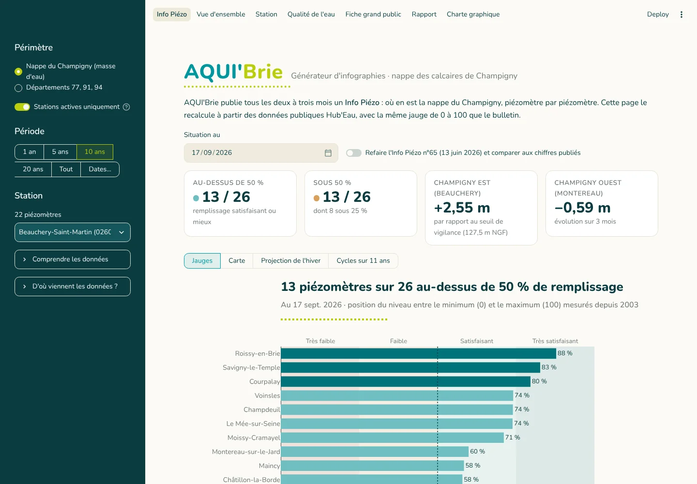
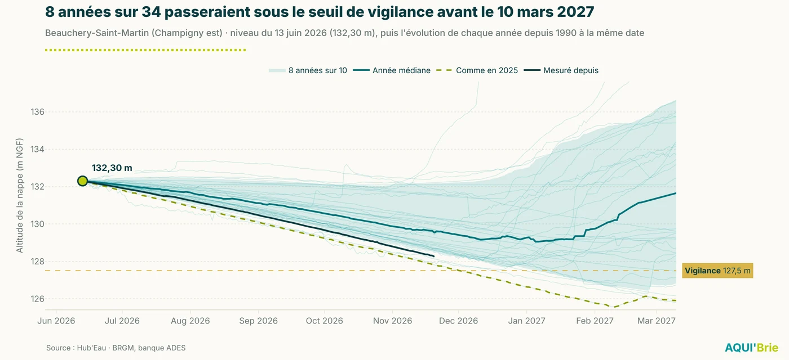
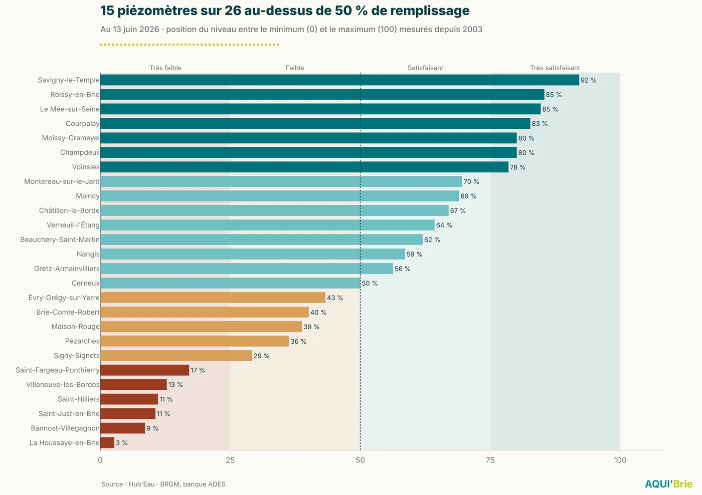
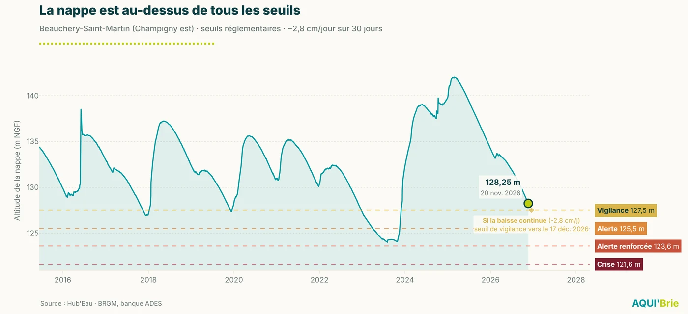
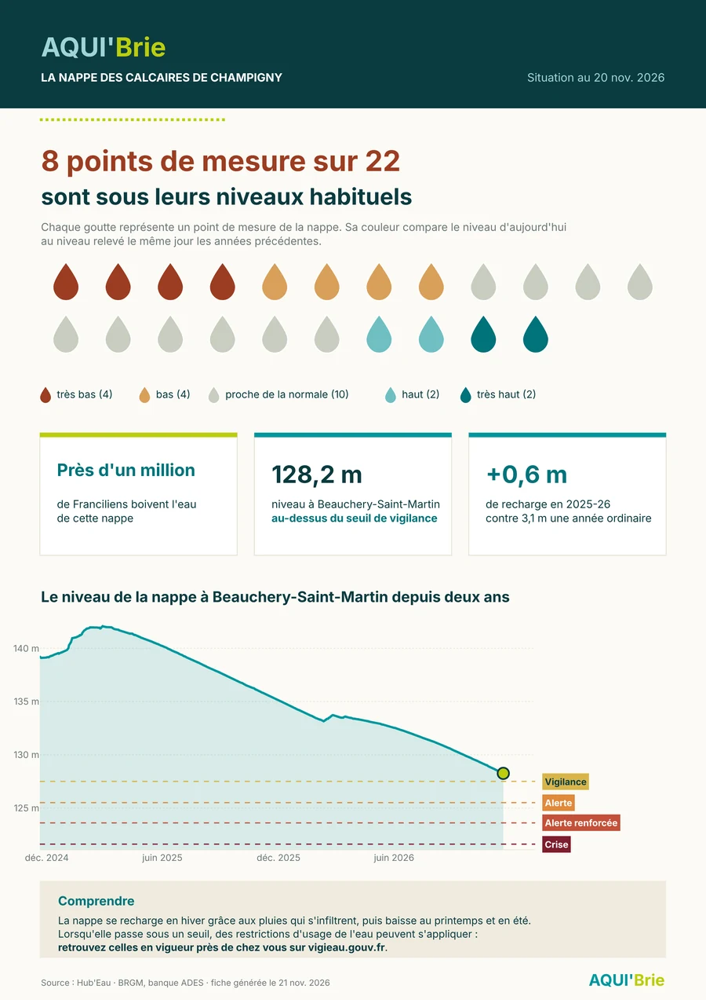
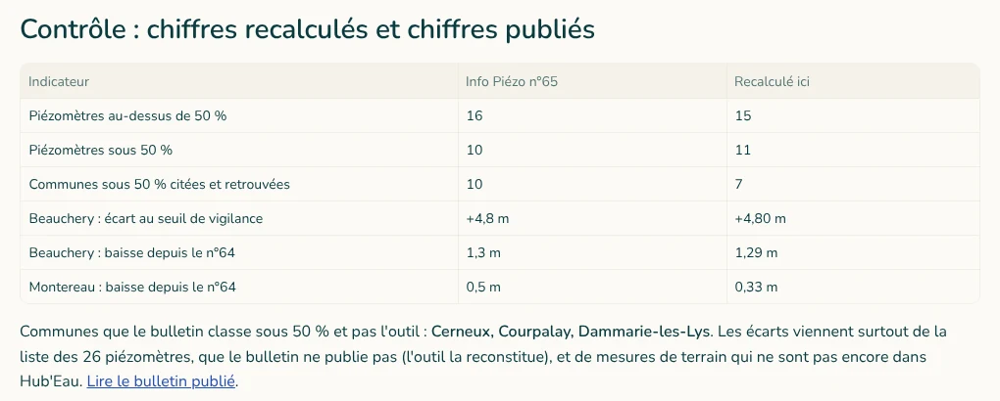

# AQUI'Brie : générateur d'infographies sur la nappe de Champigny

[](https://github.com/MatALass/Aqui-Brie/actions/workflows/ci.yml)

Projet d'équipe EFREI (ING3, 4 étudiants) pour un vrai commanditaire : **l'association AQUI'Brie**,
qui suit la nappe des calcaires de Champigny, une réserve qui alimente en eau potable près d'un
million de Franciliens. Le besoin exprimé en réunion : leurs rapports dépassent 200 pages, et
leurs figures sont refaites à la main à chaque mise à jour.

L'application Streamlit produit ces figures à partir des données publiques
[Hub'Eau](https://hubeau.eaufrance.fr) (BRGM, banque ADES), les mêmes que celles qu'AQUI'Brie
cite dans ses bulletins, et les exporte en PNG, SVG, PDF, PowerPoint ou Word.



## Le résultat : l'Info Piézo n°65 refait à partir des données publiques

AQUI'Brie publie tous les deux à trois mois un **Info Piézo**, qui situe chaque piézomètre sur
une jauge de 0 à 100 (le niveau du jour entre le minimum et le maximum mesurés depuis 2003).
J'ai refait le [n°65](https://www.aquibrie.fr/publications/info-piezo-ndeg65-avril-juin-2026)
(mesures du 13 juin 2026) avec l'outil, puis comparé chiffre par chiffre :

| Indicateur | Publié | Recalculé |
| --- | --- | --- |
| Beauchery-Saint-Martin, écart au seuil de vigilance | +4,8 m | **+4,80 m** |
| Beauchery-Saint-Martin, baisse depuis le n°64 | 1,3 m | **1,29 m** |
| Piézomètres au-dessus de 50 % | 16 sur 26 | 15 sur 26 |
| Communes citées sous 50 % et retrouvées | 10 | 7 |
| Montereau-sur-le-Jard, baisse depuis le n°64 | 0,5 m | 0,33 m |

Les chiffres des piézomètres de référence tombent juste. Les écarts sur le décompte viennent
de la liste des 26 piézomètres, que le bulletin ne publie pas : je l'ai reconstituée à partir
de Hub'Eau (détails dans [Limites connues](#limites-connues)).

**Ce que l'outil ajoute au bulletin : une projection par analogie.** Le n°65 annonçait que
Beauchery-Saint-Martin pourrait passer sous le seuil de vigilance début décembre. L'outil
rejoue, à partir du niveau du 13 juin, l'évolution de chacune des 34 années passées depuis
1990 :

- 8 années sur 34 font passer la nappe sous le seuil de vigilance avant mars 2027 ;
- « comme en 2025 », le franchissement tombe le 3 décembre 2026, ce qui rejoint le bulletin ;
- les mesures réelles reçues depuis (trait foncé) suivent la bande basse : au 20 novembre 2026,
  la nappe est à 128,25 m, soit **0,75 m au-dessus du seuil de vigilance**, et au rythme du
  dernier mois elle l'atteindrait vers le 17 décembre.



## Lancer l'application

```powershell
pip install -e ".[dev]"
streamlit run app.py
```

L'application tourne aussi **sans Internet** : une copie figée des données Hub'Eau
(`src/aquibrie_viz/instantane`, 4,3 Mo, 32 piézomètres, données au 21 novembre 2026) est
livrée avec le paquet. Quand Hub'Eau répond, les données sont mises à jour par-dessus.

```powershell
$env:AQUIBRIE_HORS_LIGNE = "1"; streamlit run app.py   # forcer le mode sans réseau
python -m aquibrie_viz.donnees --instantane             # régénérer l'instantané
```

### Démo en ligne (Streamlit Community Cloud)

Sur [share.streamlit.io](https://share.streamlit.io) : *Create app*, dépôt `MatALass/Aqui-Brie`,
branche `main`, fichier `app.py`, Python 3.12. Les dépendances viennent de `requirements.txt`.

## Exemples d'exports

| Jauges de l'Info Piézo (13 juin 2026) | Chronique et seuils réglementaires |
| --- | --- |
|  |  |

| Fiche grand public A4 | Contrôle face au bulletin publié |
| --- | --- |
|  |  |

## Ce que montre l'application

| Page | Infographies | À quoi elles servent |
| --- | --- | --- |
| Info Piézo | Jauges 0 à 100 · carte · projection de l'hiver · cycles sur 11 ans · contrôle face au n°65 | Refaire le bulletin d'AQUI'Brie en un clic |
| Vue d'ensemble | Indicateurs clés · carte de situation · classement des stations | Voir d'un coup d'œil quelles zones de la nappe sont basses |
| Station | Indicateurs clés · chronique avec seuils et projection · année vs historique · recharge annuelle · calendrier des écarts mensuels | Suivre un piézomètre, anticiper le franchissement d'un seuil |
| Qualité de l'eau | Indicateurs clés · carte des stations · évolution annuelle · détail par station · tableau | Localiser les dépassements de norme et suivre leur évolution |
| Fiche grand public | Une page A4 « La nappe aujourd'hui » | Sensibiliser : mairies, lettres d'information, salons |
| Rapport | Composition et génération d'un rapport complet | Régénérer d'un clic toutes les figures d'un rapport |
| Charte graphique | Palette, typographie, règles | La proposition « Strates & eau » |

Chaque infographie s'exporte en PNG haute résolution, SVG, PDF et HTML interactif, et
s'accompagne d'une aide « Comment lire ce graphique ? ». Un bouton « ＋ Ajouter au
rapport » l'ajoute au rapport en cours. Un glossaire est disponible dans la barre latérale.

## Fiche grand public (`src/aquibrie_viz/fiche.py`)

Une page A4 portrait (export PNG 300 dpi ou PDF) qui se lit en dix secondes :

- un message principal calculé à partir des données (« 7 points de mesure sur 22 sont
  sous leurs niveaux habituels ») ;
- une goutte par point de mesure, colorée selon sa situation ;
- trois chiffres clés : habitants alimentés (chiffre d'AQUI'Brie), dernier niveau de la
  station de référence par rapport aux seuils, dernière recharge comparée à une année
  ordinaire ;
- la courbe des deux dernières années de la station de référence ;
- un encart pédagogique qui renvoie vers vigieau.gouv.fr pour les restrictions en vigueur.

## Mode rapport (`src/aquibrie_viz/rapport.py`)

Le besoin principal exprimé en réunion : les rapports d'AQUI'Brie dépassent 200 pages,
et leurs figures sont refaites à la main à chaque mise à jour.

1. **Composer** : dans l'interface, « ＋ Ajouter au rapport » sous chaque infographie,
   ou partir de `rapports/exemple_bulletin.toml`.
2. **Enregistrer** : le rapport est un petit fichier texte (.toml) qui décrit chaque
   figure en termes relatifs (« les 10 dernières années », « la dernière année »).
3. **Régénérer** : le même fichier, relancé plus tard, produit les figures à jour.

Sorties possibles : images PNG, SVG ou PDF ; une présentation **PowerPoint** à la charte
(une couverture, puis une figure par diapositive) ; un document **Word**. Pour le Word,
deux options :

- **avec un gabarit** : un document Word normal, rédigé par l'association, contenant des
  balises `{{ fig_<id> }}` là où vont les figures et `{{ titre_<id> }}` pour reprendre
  leur titre. Le texte reste celui de l'auteur, seules les figures sont remplacées.
  Exemple : `rapports/gabarit_exemple.docx` ;
- **sans gabarit** : un document simple, une figure par section.

En ligne de commande, sans interface (utile pour une tâche planifiée chaque mois) :

```powershell
python -m aquibrie_viz.rapport rapports/exemple_bulletin.toml --sortie sorties --gabarit rapports/gabarit_exemple.docx
```

Une figure dont les données manquent est signalée sans bloquer les autres. Si le fond de
carte est inaccessible (pas d'Internet), les cartes sont exportées sans fond et signalées.
Les stations du fichier d'exemple sont réelles (Beauchery-Saint-Martin) mais choisies
pour la démonstration : à remplacer par celles des rapports de l'association.

### Indicateurs calculés (`src/aquibrie_viz/indicators.py`)

- **Situation d'une station** : rang du dernier niveau parmi les niveaux du même jour
  (± 3 jours) des années précédentes, en 5 classes, de « très bas » à « très haut ».
  Il faut au moins 5 ans d'historique. Le calcul est inspiré des bulletins de
  situation des nappes du BRGM, mais simplifié en percentiles : ce n'est pas l'IPS
  officiel.
- **Projection** : si le niveau baisse, date à laquelle le prochain seuil serait atteint
  au rythme des 30 derniers jours (extrapolation linéaire, horizon 1 an).
- **Recharge** : plus forte remontée du niveau dans l'année hydrologique (septembre →
  août). Elle vaut zéro les années où la nappe ne fait que baisser. Elle est calculée
  sur les mesures brutes, quelle que soit leur fréquence ; une année doit avoir au moins
  8 mois mesurés, dont l'automne, pour être retenue.
- **Écarts mensuels** : niveau moyen du mois moins la médiane de ce mois sur tout
  l'historique.
- **Lacunes** : les trous de mesure de plus de 15 jours ne sont pas interpolés. La
  courbe est interrompue plutôt que d'inventer des données.

## Les données (API Hub'Eau)

| Usage | Requête |
| --- | --- |
| Piézomètres de la nappe | `https://hubeau.eaufrance.fr/api/v1/niveaux_nappes/stations?codes_masse_eau_edl=HG103` |
| Repli par département | `.../niveaux_nappes/stations?code_departement=77` (puis 91, 94) |
| Mesures d'une station | `.../niveaux_nappes/chroniques?code_bss=…&date_debut_mesure=…&date_fin_mesure=…` |
| Analyses de qualité | `.../qualite_nappes/analyses?code_param=…&code_masse_eau_edl=HG103&date_debut_prelevement=…&date_fin_prelevement=…` |

- **HG103** est la masse d'eau « Tertiaire du Brie-Champigny et du Soissonnais ». Si
  l'API ne renvoie aucune station pour ce code, l'application bascule sur les
  départements 77, 91 et 94.
- **Qualité** : les analyses sont demandées pour toute la masse d'eau, sans passer par
  un identifiant de station. Hub'Eau limitant une requête à 20 000 enregistrements, elles
  sont découpées par année. Si une année dépasse quand même cette limite, l'application
  affiche une erreur plutôt que des données tronquées.
- **Seuils réglementaires** : ceux de Beauchery-Saint-Martin (127,5 / 125,5 / 123,6 /
  121,6 m NGF) sont repris du document d'AQUI'Brie (`src/aquibrie_viz/reference.py`).
  Pour les autres stations, des seuils indicatifs réglables sont proposés et signalés
  comme tels.
- **Substances** (`reference.py`) : nitrates (1340), atrazine (1107), atrazine déséthyl (1108),
  glyphosate (1506), AMPA (1907), avec leurs codes SANDRE. Les codes sont à confirmer
  avec AQUI'Brie, qui pourra en ajouter.

## Installation (Windows, PowerShell)

Prérequis : Python 3.11 ou plus récent, Google Chrome (nécessaire aux exports PNG/SVG)
et une connexion Internet.

```powershell
cd Aqui-Brie
python -m venv .venv
.venv\Scripts\Activate.ps1
pip install -e ".[dev]"
streamlit run app.py
```

L'application s'ouvre à l'adresse `http://localhost:8501`. Le tout premier lancement
télécharge l'historique des stations (quelques secondes à quelques dizaines de secondes
selon Hub'Eau). Ensuite, tout vient du cache local (voir ci-dessous). Si Hub'Eau est lent,
chaque requête est réessayée deux fois. Une station qui ne répond toujours pas est
signalée, sans empêcher l'affichage des autres.

## Performance et cache

Trois niveaux, du plus durable au plus rapide :

| Niveau | Où | Ce qu'il évite |
| --- | --- | --- |
| Cache disque (`donnees.py`) | `~/.cache/aquibrie` ou variable `AQUIBRIE_CACHE` | Retélécharger après un redémarrage. L'historique n'est téléchargé qu'une fois ; seules les 3 dernières semaines sont redemandées toutes les 6 h. Analyses de qualité : années passées figées, année en cours rafraîchie chaque jour. Si Hub'Eau est en panne, la dernière copie est utilisée. |
| Cache mémoire (`st.cache_data`) | serveur Streamlit, partagé entre utilisateurs | Relire le disque et recalculer (situation, recharge, synthèses) à chaque clic. |
| Affichage | `app.py` | Une seule page s'exécute à la fois ; exporter, ajouter au rapport, changer d'année ou de station qualité ne réexécute qu'un fragment. Les aperçus de fiche sont gardés sur disque. Chrome reste ouvert entre deux exports (≈ 0,35 s au lieu de ≈ 2,3 s). |

Mesures sur Hub'Eau simulé (350 ms par requête, 22 stations) :

| Action | v0.4 | v0.5 |
| --- | --- | --- |
| Premier lancement (cache vide) | 15,0 s | 4,2 s |
| Changer de période | 1,7 s | 0,1 s |
| Changer de station | 6,2 s | 0,1 s (vue d'ensemble) · 0,7 s (page Station, historique complet) |
| Redémarrage du serveur | 12,7 s | 0,7 s, aucune requête |

**Sur le serveur d'AQUI'Brie**, planifier chaque nuit (Planificateur de tâches Windows) :

```powershell
python -m aquibrie_viz.donnees
```

Le cache est alors toujours à jour et aucun utilisateur n'attend Hub'Eau. Le bouton
« Actualiser maintenant » (barre latérale, « D'où viennent les données ? ») force une mise
à jour sans perdre l'historique. Supprimer le dossier du cache force un retéléchargement
complet.

Pour que les PNG et SVG exportés utilisent la police de la charte, installer
`static/Nunito.ttf` sur le poste (clic droit, puis « Installer »).

## Structure

```
app.py                      # interface Streamlit : aucun calcul, aucune figure
.streamlit/config.toml      # thème de l'interface
static/Nunito.ttf           # police de la charte (licence OFL)
src/aquibrie_viz/
    hubeau.py               # client de l'API Hub'Eau (remplacé plus tard par SQL Server)
    donnees.py              # cache disque incrémental au-dessus de hubeau.py, repli sur l'instantané
    instantane/             # copie figée des données Hub'Eau, pour tourner sans réseau
    bulletin.py             # Info Piézo : jauge 0-100, tranches, projection par analogie
    indicators.py           # situation, projection, recharge, écarts, synthèses qualité
    reference.py            # masse d'eau, départements, seuils, substances suivies
    fiche.py                # fiche grand public A4
    rapport.py              # mode rapport : fichier .toml, PNG, PowerPoint, Word, ligne de commande
    theme.py                # charte graphique
    templates.py            # les 12 modèles d'infographies
    export.py               # PNG, SVG, PDF, HTML
rapports/                   # rapport d'exemple (.toml) et gabarit Word d'exemple
tests/                      # pytest : API simulée ou instantané, aucun réseau requis
scripts/smoke_pages.py      # ouvre chaque page de l'application lancée (API agent de Streamlit)
```

## Tests

```powershell
pytest
```

79 tests, sans réseau. En CI (GitHub Actions, à chaque push) : `ruff check`, les tests, puis
l'application est lancée hors ligne et chaque page est ouverte une par une
(`scripts/smoke_pages.py`) : la CI échoue sur la moindre exception affichée.

## Limites connues

- **La liste des 26 piézomètres de l'Info Piézo est reconstituée.** Le bulletin ne donne pas
  leurs codes. J'ai pris les 26 piézomètres actifs en 2026 qui captent le Champigny : le réseau
  départemental (codes `/P1` à `/P19`, suivis depuis 2002-2003, sans masse d'eau renseignée
  dans Hub'Eau, donc absents d'une recherche par masse d'eau) et ceux de la masse d'eau HG103.
  Sur les 10 communes que le bulletin classe sous 50 %, trois ne sortent pas comme lui :
  Cerneux est à 50,0 % pile, Courpalay ressort à 83 % sans que je sache expliquer l'écart, et
  le piézomètre de Dammarie-les-Lys n'envoie plus de mesures à Hub'Eau depuis 2018. La liste
  exacte est à demander à AQUI'Brie.
- **Montereau-sur-le-Jard n'a pas de seuils réglementaires dans l'outil.** Ils sont fixés par
  l'arrêté-cadre sécheresse de Seine-et-Marne n° 2024/DDT/SEPR/191, dont je n'ai pas trouvé
  les valeurs en ligne : l'outil affiche des seuils indicatifs, signalés comme tels. La baisse
  publiée (0,5 m) correspond à un départ au pic du 14 mars (51,63 m, soit 0,49 m de baisse) ;
  depuis la date du n°64 (16 mars), elle est de 0,33 m.
- **Le réseau départemental arrive dans Hub'Eau par lots** (dernier lot reçu : mesures
  jusqu'au 17 septembre 2026). La page Info Piézo se place donc par défaut à la date la plus
  récente couverte par au moins 80 % des piézomètres, et signale ceux qui n'ont pas de mesure.
- **La projection par analogie n'est pas une prévision** : elle montre ce que la nappe a déjà
  fait à la même saison, sans tenir compte de la météo à venir.
- **La carte** charge son fond de plan depuis Internet (CARTO, OpenStreetMap).
- **Seuils** : seul Beauchery-Saint-Martin a des seuils réglementaires renseignés.
- **Qualité** : la période commence au plus tôt en 2000, pour limiter le nombre de
  requêtes.
